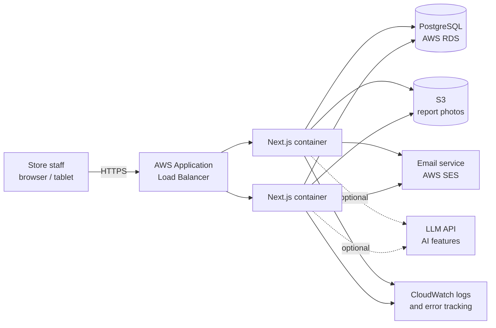
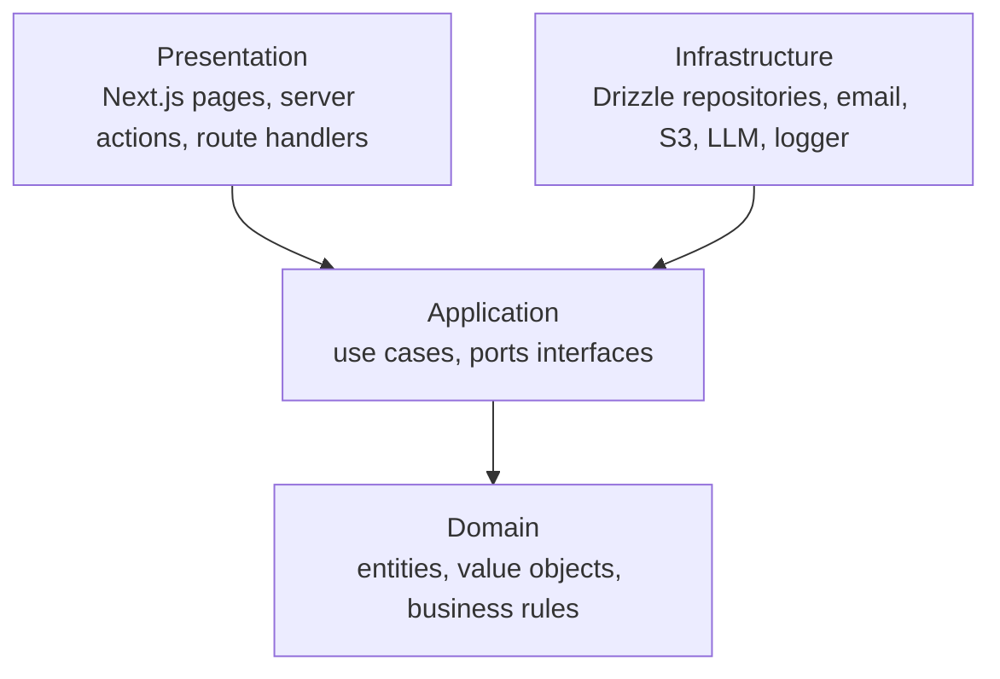
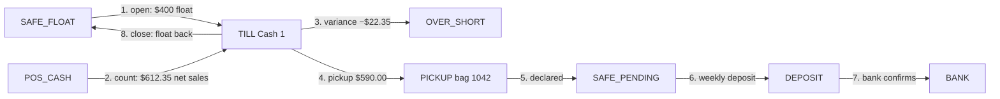
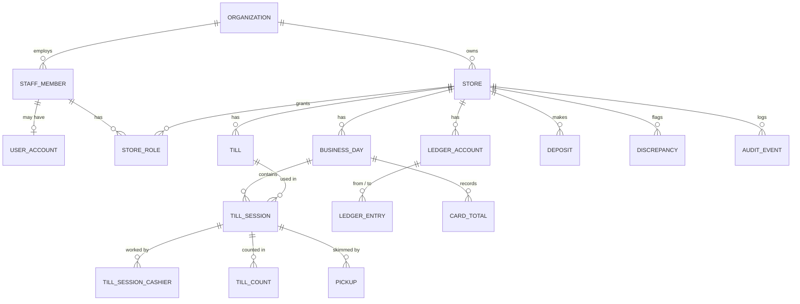
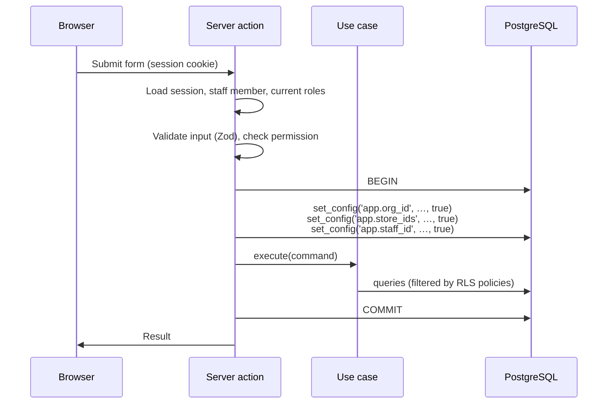
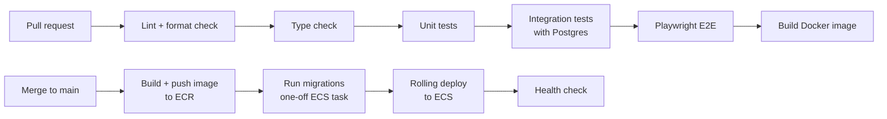

# TillTrack — Architecture and Design

Version 0.1 · Draft · Companion to [requirements.md](requirements.md)

## 1. Overview

TillTrack is a **modular monolith**: one deployable Next.js application, internally split into feature modules with strict boundaries. Each module follows **Clean Architecture**: business rules live in plain TypeScript with no framework or database code, and outer layers depend on inner layers, never the reverse.

The application is **stateless**. All state lives in PostgreSQL, so any number of identical containers can run behind a load balancer.

### Why not microservices?

| Concern      | Modular monolith                                                    | Microservices                                                     |
| ------------ | ------------------------------------------------------------------- | ----------------------------------------------------------------- |
| Transactions | One database transaction can move money and write history together. | Needs distributed transactions or sagas for every money movement. |
| Operations   | One service to deploy, monitor and debug.                           | Many services, a network between them, service discovery.         |
| Team size    | Fits a small team.                                                  | Pays off with many independent teams.                             |
| Future split | Module boundaries are enforced, so a module can be extracted later. | Already split.                                                    |

Money correctness depends on atomic transactions, so a single database and a single deployable is the sound choice at this scale.

## 2. System context



| Component          | Purpose                                                                          |
| ------------------ | -------------------------------------------------------------------------------- |
| Load balancer      | Terminates HTTPS, spreads traffic across containers, runs health checks.         |
| Next.js containers | Serve pages and handle all actions. Identical and stateless. Run on ECS Fargate. |
| PostgreSQL (RDS)   | Single source of truth. Enforces tenant isolation with row-level security.       |
| S3                 | Stores photos of Z reports and batch slips (FR-52).                              |
| SES                | Sends invitations, password resets and alerts.                                   |
| LLM API            | Optional AI features. The app works fully without it (NFR-13).                   |

## 3. Layers (Clean Architecture)



Arrows show the direction of dependency. The domain depends on nothing.

| Layer              | Contains                                                                                                                                         | Must not import                    |
| ------------------ | ------------------------------------------------------------------------------------------------------------------------------------------------ | ---------------------------------- |
| **Domain**         | `Money`, `TillSession`, `Pickup`, variance rules, dual-control rule, role rules. Pure functions and classes.                                     | Next.js, Drizzle, React, Node APIs |
| **Application**    | Use cases such as `RecordPickup`, `DeclarePickup`, `CloseBusinessDay`. Defines **ports**: interfaces like `PickupRepository`, `Clock`, `Mailer`. | Next.js, Drizzle, React            |
| **Infrastructure** | **Adapters** that implement ports: Drizzle repositories, SES mailer, S3 storage, LLM client, structured logger.                                  | Presentation                       |
| **Presentation**   | Next.js routes, server actions, React components. Parses input, calls one use case, renders the result.                                          | Drizzle, SQL                       |

Boundaries are enforced automatically in CI with `dependency-cruiser`, so a violation fails the build rather than relying on code review.

### Design patterns used, and where

| Pattern                  | Where                                                                                         | Why                                                                                     |
| ------------------------ | --------------------------------------------------------------------------------------------- | --------------------------------------------------------------------------------------- |
| **Repository**           | One repository per aggregate (e.g. `PickupRepository`).                                       | Use cases don't know SQL exists; tests use in-memory fakes.                             |
| **Unit of Work**         | `withTenantTransaction()` wraps each use case.                                                | Ledger entries, record changes and history are saved together or not at all.            |
| **Dependency Injection** | Constructor injection, wired in one **composition root**.                                     | Loose coupling; swap real adapters for fakes in tests.                                  |
| **Factory**              | `Money.fromCents()`, `Money.fromDollarsString()`; use case factories in the composition root. | Valid objects only; one place to build dependency graphs.                               |
| **Value Object**         | `Money`, `BusinessDate`, `BagNumber`, `Role`.                                                 | Invalid values cannot exist (e.g. negative or fractional cents).                        |
| **Result type**          | Domain and use case return values.                                                            | Expected failures (e.g. "verifier is the counter") are explicit values, not exceptions. |
| **Adapter**              | Mailer, storage, LLM, clock.                                                                  | External services are replaceable behind an interface.                                  |

## 4. Folder structure

```text
tilltrack/
├── src/
│   ├── app/                      # Presentation: Next.js App Router
│   ├── ui/                       # Presentation: shared React components
│   ├── modules/
│   │   ├── organizations/        # orgs, stores, settings
│   │   ├── staff/                # staff, roles, accounts
│   │   ├── tills/                # till sessions, counts
│   │   ├── pickups/              # pickups, declaring, verifying
│   │   ├── ledger/               # money movements and balances
│   │   ├── safe/                 # safe counts
│   │   ├── deposits/             # deposits, carrier, bank
│   │   ├── cards/                # card reconciliation
│   │   ├── discrepancies/        # flags and resolution
│   │   ├── business-days/        # day close, reports
│   │   └── audit/                # history
│   │       # each module contains:
│   │       #   domain/  application/  infrastructure/
│   ├── shared/
│   │   ├── domain/               # Money, Result, base errors
│   │   ├── application/          # shared ports (Clock, Logger)
│   │   └── infrastructure/       # db client, tenant context, logger
│   └── composition-root.ts       # wires adapters into use cases
├── db/
│   ├── schema/                   # Drizzle table definitions
│   ├── migrations/               # generated SQL migrations
│   └── policies/                 # RLS policies and grants (SQL)
├── tests/
│   ├── integration/              # repositories and RLS against real Postgres
│   └── e2e/                      # Playwright
├── infra/                        # Terraform
├── docs/
└── .github/workflows/
```

Modules only talk to each other through their application layer, never by reaching into another module's tables.

## 5. Key technology decisions

| Decision   | Choice                                     | Reason                                                                                                                                                                                                 |
| ---------- | ------------------------------------------ | ------------------------------------------------------------------------------------------------------------------------------------------------------------------------------------------------------ |
| ORM        | **Drizzle**                                | Close to SQL, so RLS session settings, policies and grants are written and reviewed as real SQL. Lightweight, strongly typed. Prisma hides more SQL, which makes per-transaction RLS settings awkward. |
| Sessions   | **Database sessions**, not long-lived JWTs | A role change or deactivation must apply on the very next request (RM-6). A stored session is checked every time; a JWT stays valid until it expires.                                                  |
| Mutations  | **Server actions** calling use cases       | Type-safe forms. Each action is treated as a public endpoint: it authenticates, validates input and checks permissions every time.                                                                     |
| Validation | **Zod** at the presentation boundary       | Untrusted input is parsed into typed values before it reaches a use case.                                                                                                                              |
| Logging    | **Pino**, JSON output                      | Structured logs with request ID, org ID and store ID; no personal data in logs.                                                                                                                        |
| Testing    | **Vitest**, **Playwright**, **fast-check** | Unit, integration and end-to-end; property-based tests prove the ledger always balances.                                                                                                               |

Exact library versions (and the auth library) are confirmed when the project is scaffolded.

## 6. The money ledger

### 6.1 Idea

Every dollar is in exactly one **account** (a location). Money never appears or disappears: every **entry** moves a positive amount _from_ one account _to_ another. This is double-entry bookkeeping, in its simplest form.

```text
balance(account) = sum(entries into it) − sum(entries out of it)
```

Because every entry subtracts from one account and adds to another, **the total of all balances is always zero**. Reports balance by construction, not by careful coding.

### 6.2 Accounts

| Account kind   | One per      | Meaning                                                    |
| -------------- | ------------ | ---------------------------------------------------------- |
| `POS_CASH`     | store        | Outside world: net cash taken from customers, per the POS. |
| `TILL`         | till session | Cash in a drawer.                                          |
| `PICKUP`       | pickup       | A pickup bag between the till and the safe.                |
| `SAFE_FLOAT`   | store        | Float money in the safe.                                   |
| `SAFE_PENDING` | store        | Cash in the safe awaiting deposit.                         |
| `DEPOSIT`      | deposit      | A deposit bag with the carrier.                            |
| `BANK`         | store        | Money confirmed by the bank.                               |
| `OVER_SHORT`   | store        | Where variances go, so every gap is visible.               |

### 6.3 A day in entries (Cash 1)



When a count is recorded, the use case first moves the POS net cash into the till, which makes the till's balance equal **expected cash**. If the counted amount differs, one more entry moves the difference to or from `OVER_SHORT`, so the till's balance always equals what is physically there.

Whether the float returns to `SAFE_FLOAT` at close or carries over in the drawer to the next day's till session is a store setting (`float_overnight`, default `drawer`). With `drawer`, entry 8 moves the float from the closing till session to the next day's till session instead of to the safe. Either way it is one entry.

### 6.4 Rules enforced by the database

- `amount_cents > 0` and `from_account_id <> to_account_id` (check constraints).
- Both accounts belong to the same store (enforced in a trigger).
- Entries are never updated or deleted (privileges plus a trigger, see section 8).
- Corrections are new entries with `reverses_entry_id` pointing to the original.

## 7. Data model

### 7.1 Core entities



### 7.2 Tables

Every tenant table has `org_id` and (except org-level tables) `store_id`. All IDs are UUIDs. All money columns are `bigint` cents. All timestamps are `timestamptz` (UTC).

**Kinds of tables**

| Kind                   | Tables                                                                                                                                           | Rule                                                                                                                                        |
| ---------------------- | ------------------------------------------------------------------------------------------------------------------------------------------------ | ------------------------------------------------------------------------------------------------------------------------------------------- |
| **Append-only**        | `ledger_entries`, `audit_events`, `till_counts`, `safe_counts`, `card_totals`, `role_changes`, `store_settings_versions`, `till_config_versions` | Insert only. Never updated or deleted.                                                                                                      |
| **Versioned workflow** | `till_sessions`, `pickups`, `deposits`, `discrepancies`, `business_days`, `staff_members`, `store_roles`                                         | Updates allowed. Each has a `version` column for optimistic locking, and every change writes an `audit_events` row in the same transaction. |
| **Reference**          | `organizations`, `stores`, `tills`, `ledger_accounts`                                                                                            | Rarely change. Changes are audited.                                                                                                         |

**Main columns**

| Table                     | Key columns                                                                                                                                                                |
| ------------------------- | -------------------------------------------------------------------------------------------------------------------------------------------------------------------------- |
| `organizations`           | id, name, created_at                                                                                                                                                       |
| `stores`                  | id, org_id, name, timezone, currency, float_overnight float_overnight (`drawer` \| `safe`, default `drawer`)                                                               |
| `store_settings_versions` | id, store_id, variance_tolerance_cents, effective_from, created_by                                                                                                         |
| `tills`                   | id, store_id, name, kind, active                                                                                                                                           |
| `till_config_versions`    | id, till_id, float_cents, limit_cents, effective_from, created_by                                                                                                          |
| `staff_members`           | id, org_id, full_name, employee_number, is_owner, status, user_id (nullable), version                                                                                      |
| `store_roles`             | id, store_id, staff_id, role, status, version                                                                                                                              |
| `role_changes`            | id, store_id, staff_id, old_role, new_role, changed_by, reason, created_at                                                                                                 |
| `business_days`           | id, store_id, business_date, status (`open` \| `closed`), closed_by, closed_at, version                                                                                    |
| `till_sessions`           | id, store_id, business_day_id, till_id, float_cents, status, opened_by, closed_at, version                                                                                 |
| `till_session_cashiers`   | id, till_session_id, staff_id, started_at, ended_at                                                                                                                        |
| `till_counts`             | id, store_id, till_session_id, kind (`mid` \| `final`), denominations (jsonb), counted_cents, pos_net_cash_cents, expected_cents, variance_cents, counted_by, counted_at   |
| `pickups`                 | id, store_id, till_session_id, bag_number, amount_cents, status (`in_transit` \| `declared` \| `verified`), declared_cents, recorded_by, declared_by, verified_by, version |
| `ledger_accounts`         | id, store_id, kind, ref_id (nullable)                                                                                                                                      |
| `ledger_entries`          | id, store_id, business_day_id, from_account_id, to_account_id, amount_cents, source_type, source_id, reverses_entry_id, created_by, created_at                             |
| `safe_counts`             | id, store_id, business_day_id, denominations, counted_cents, expected_cents, counted_by, counted_at                                                                        |
| `deposits`                | id, store_id, bag_number, amount_cents, status, carrier_name, carrier_receipt, handed_over_at, bank_confirmed_cents, confirmed_at, version                                 |
| `card_totals`             | id, store_id, business_day_id, source (`pos` \| `terminal` \| `bank`), card_type, amount_cents, fee_cents, supersedes_id, entered_by                                       |
| `discrepancies`           | id, store_id, business_day_id, source_type, source_id, amount_cents, status, found_by, resolved_by, version                                                                |
| `discrepancy_notes`       | id, discrepancy_id, author_id, status_from, status_to, note, created_at                                                                                                    |
| `audit_events`            | id, org_id, store_id, actor_staff_id, action, entity_type, entity_id, before (jsonb), after (jsonb), request_id, created_at                                                |
| `idempotency_keys`        | store_id, key, user_id, result (jsonb), created_at                                                                                                                         |

**Integrity constraints (examples)**

- One till session per till per business day: unique `(till_id, business_day_id)`.
- Bag numbers unique while open: partial unique index on `pickups (store_id, bag_number) WHERE status <> 'verified'`.
- Counted cash is a multiple of 5¢: `CHECK (counted_cents % 5 = 0)` (BR-2).
- One open business day per date: unique `(store_id, business_date)`.

## 8. Multi-tenancy and row-level security

### 8.1 Two database roles

| Role                 | Used by                 | Can                                                                                                                 |
| -------------------- | ----------------------- | ------------------------------------------------------------------------------------------------------------------- |
| `tilltrack_migrator` | Migrations only         | Owns the tables, creates policies and grants.                                                                       |
| `tilltrack_app`      | The running application | Read and write through RLS only. Not a table owner, no `BYPASSRLS`. Has no `UPDATE`/`DELETE` on append-only tables. |

### 8.2 How a request is scoped



- `set_config(…, true)` makes the settings **local to the transaction**. When the connection returns to the pool, the settings are gone, so one request's tenant can never leak into the next.
- Policies read the settings with `current_setting('app.org_id', true)`. If a setting is missing, it is `NULL`, the comparison fails, and **no rows are visible**. Forgetting to set the tenant fails closed, not open.
- Every tenant table has `ENABLE ROW LEVEL SECURITY` and `FORCE ROW LEVEL SECURITY`.

### 8.3 Example policy

```sql
CREATE POLICY pickups_tenant_isolation ON pickups
  USING (
    org_id = current_setting('app.org_id', true)::uuid
    AND store_id = ANY (string_to_array(current_setting('app.store_ids', true), ',')::uuid[])
  )
  WITH CHECK (
    org_id = current_setting('app.org_id', true)::uuid
    AND store_id = ANY (string_to_array(current_setting('app.store_ids', true), ',')::uuid[])
  );
```

`USING` controls which rows can be read or changed. `WITH CHECK` stops a user from inserting a row into another tenant.

### 8.4 Append-only, enforced twice

1. **Privileges:** `REVOKE UPDATE, DELETE ON ledger_entries, audit_events, … FROM tilltrack_app;`
2. **Trigger:** a `BEFORE UPDATE OR DELETE` trigger raises an exception, protecting the data even from a misconfigured grant.

### 8.5 RLS and permissions are different jobs

RLS answers **"which store's data can this request touch?"** The application's permission check answers **"is this person allowed to do this action?"** (the matrix in the requirements). Both run on every request.

## 9. Concurrency

| Problem                                          | Solution                                                                                                                                                                                                     |
| ------------------------------------------------ | ------------------------------------------------------------------------------------------------------------------------------------------------------------------------------------------------------------ |
| Two managers edit the same discrepancy           | **Optimistic locking:** `UPDATE … SET …, version = version + 1 WHERE id = $1 AND version = $2`. Zero rows updated means someone else changed it first: return a `ConflictError` and show the latest version. |
| Two people open the same till                    | Unique constraint `(till_id, business_day_id)`. The second insert fails cleanly.                                                                                                                             |
| Double tap on "Save"                             | **Idempotency key:** each form gets a UUID. The first request stores its result under that key; a repeat returns the stored result.                                                                          |
| Closing a day while a pickup is being declared   | `CloseBusinessDay` locks the business day row (`SELECT … FOR UPDATE`) and re-checks for undeclared pickups inside the same transaction.                                                                      |
| Two counts move money from the same till at once | Each use case runs in one transaction. Balance checks read with `FOR UPDATE` on the till session row.                                                                                                        |

## 10. Error handling

| Kind                          | Example                                     | Handling                                                                                                         |
| ----------------------------- | ------------------------------------------- | ---------------------------------------------------------------------------------------------------------------- |
| **Expected business failure** | Verifier is the counter; day already closed | Returned as a typed `Result` failure with a code. Shown to the user as a clear message.                          |
| **Conflict**                  | Optimistic lock failed                      | `ConflictError`; UI reloads the latest data.                                                                     |
| **Invalid input**             | Amount `"12.345"`                           | Rejected by Zod before reaching the use case.                                                                    |
| **Not found / forbidden**     | Another store's ID                          | Treated the same (`NotFound`) so IDs from other tenants are not revealed.                                        |
| **Unexpected**                | Database down                               | Thrown, logged with request ID, reported to error tracking; the user sees a generic message with a reference ID. |

## 11. Money and time

- **`Money`** is a value object wrapping integer cents. It has no constructor that accepts a float. Parsing `"12.35"` from a form uses string arithmetic, never `parseFloat`. Arithmetic checks results stay within safe integer range.
- Columns are `bigint`; values are read as JavaScript numbers after a safe-integer check (`Number.MAX_SAFE_INTEGER` cents is far beyond any store's takings).
- **Business dates** are calculated in the store's time zone. Timestamps are stored in UTC. Tests cover Newfoundland's UTC−3:30 / −2:30 offsets and daylight-saving changes.

## 12. Security

- Passwords hashed with a modern algorithm (via the auth library). Sessions in the database, `HttpOnly`, `Secure`, `SameSite=Lax` cookies.
- Rate limiting on login and password reset, stored in PostgreSQL so it works across containers.
- Secrets in AWS Secrets Manager; nothing secret in the repo or in images.
- Security headers (CSP, HSTS) set by the app.
- Dependency updates automated (Dependabot); CodeQL scanning in CI.

## 13. Scalability

| Dimension                    | Now                                      | When needed                                                    |
| ---------------------------- | ---------------------------------------- | -------------------------------------------------------------- |
| App traffic                  | 2 containers, auto-scaling on CPU        | More containers. No code change, because the app is stateless. |
| DB connections               | Connection pool per container            | RDS Proxy in front of the database.                            |
| Report queries               | Indexes on `(store_id, business_day_id)` | Read replica for reports; materialized daily summaries.        |
| Data growth                  | Single tables                            | Partition `ledger_entries` and `audit_events` by month.        |
| Background work (emails, AI) | Done after the transaction commits       | A job queue (e.g. SQS) if volume requires it.                  |

## 14. Testing strategy

| Level          | Tool                               | Covers                                                                                          |
| -------------- | ---------------------------------- | ----------------------------------------------------------------------------------------------- |
| Unit           | Vitest                             | Domain rules: variance, dual control, role rules, `Money`. No database.                         |
| Property-based | fast-check                         | Random sequences of money movements always leave total balances at zero.                        |
| Use case       | Vitest + in-memory fakes           | Application logic, fast and isolated.                                                           |
| Integration    | Vitest + real PostgreSQL in Docker | Repositories, migrations, **RLS isolation tests**, append-only enforcement, optimistic locking. |
| End-to-end     | Playwright                         | A full business day in the browser, from opening tills to the end-of-day report.                |

## 15. CI/CD



Infrastructure changes run `terraform plan` on pull requests and `terraform apply` after merge, with remote state stored in S3.

## 16. AWS infrastructure

| Resource        | Notes                                                                        |
| --------------- | ---------------------------------------------------------------------------- |
| VPC             | Public subnets for the load balancer; private subnets for the database.      |
| ECS Fargate     | Runs the app containers; rolling deploys with health checks.                 |
| RDS PostgreSQL  | Private; automated daily backups; Multi-AZ can be enabled with one variable. |
| ECR             | Stores Docker images.                                                        |
| Secrets Manager | Database credentials and API keys.                                           |
| S3              | Report photos (private bucket) and Terraform state.                          |
| SES             | Transactional email.                                                         |
| CloudWatch      | Logs, metrics, alarms.                                                       |
| AWS Budgets     | Cost alarm, so a demo project never produces a surprise bill.                |

Network layout trades cost against isolation (for example, NAT gateways cost money every hour). The chosen layout and its trade-offs are recorded when the Terraform is written.

## 17. Build milestones

| #   | Milestone             | Done when                                                                                                  |
| --- | --------------------- | ---------------------------------------------------------------------------------------------------------- |
| 1   | Scaffold              | Next.js + TypeScript strict, lint, format, Docker Compose Postgres, CI running lint, type check and tests. |
| 2   | Database foundation   | Drizzle schema for orgs, stores, staff; migrations; two DB roles; RLS with isolation tests.                |
| 3   | Domain core           | `Money`, `Result`, ledger accounts and entries, property tests.                                            |
| 4   | Auth and staff        | Sign-up, login, sessions, invitations, roles and rules RM-1 to RM-8.                                       |
| 5   | Tills and counts      | Till sessions, cashiers, counts, variance, discrepancies.                                                  |
| 6   | Pickups and safe      | Pickups, declare, verify, safe counts.                                                                     |
| 7   | Day close and reports | Card totals, close day, end-of-day report.                                                                 |
| 8   | Deposits              | Deposit lifecycle and bank adjustments.                                                                    |
| 9   | E2E and deploy        | Playwright suite; Terraform; deploy on merge.                                                              |
| 10  | Demo and polish       | Seeded demo, README with screenshots and design notes.                                                     |
| 11  | Insights and AI       | Anomaly flags, report scanning, daily briefing, ask-your-data.                                             |
